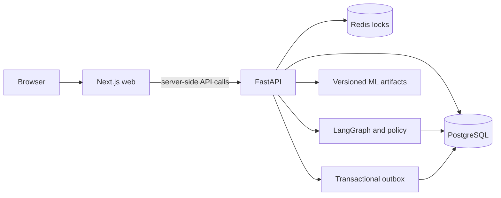

# InvoiceIQ

InvoiceIQ is a B2B invoice monitoring and recovery application. It combines
invoice and payment records, evaluated payment risk models, a policy-gated
LangGraph recovery workflow, company-scoped review, and a live financial
workspace. It is in **release verification**, not publicly deployed. Do not
interpret the demonstration payment route or model forecasts as actual payment
processing or guarantees of collection.

## Architecture



The frontend serves four retained dashboard pages: overview, invoices, cases,
and approvals. The Next.js server proxies allowlisted backend endpoints and
keeps the workspace credential in an HTTP-only cookie. FastAPI enforces
company scopes on financial reads and recovery writes; reviewers have separate
credentials and company scopes. Hosted writes require an operator credential.
The browser does not need cross-origin API access. PostgreSQL stores invoices,
payments, cases, audits, inference records and outbox events. Redis coordinates
concurrent recovery actions. In the single-process fallback, locks are
in-process. The outbox can use its log publisher without Kafka.

The stack is Python 3.12+, FastAPI, SQLAlchemy/asyncpg, Alembic, PostgreSQL 16,
LangGraph, LightGBM and the evaluated model artifacts; Next.js 16, React 19,
TypeScript, and Playwright are used for the web application and browser checks.
The model artifacts and their calibration policies are versioned and verified
without retraining at startup.

The B2B champion predicts late payment from an ordered feature schema and
returns native TreeSHAP explanations. BPI survival estimates a separate
purchase-to-pay process-clearance target; its probabilities are not customer
payment or recovery estimates. Evaluation and calibration reports remain in
`backend/app/ml/artifacts`, with methodology and limitations in
`backend/EVALUATION_PROTOCOL.md` and [the architecture guide](docs/ARCHITECTURE.md).

## Local setup

Requirements: Docker Desktop, Python 3.12+, Node.js 22 and npm. For ordinary
local development, `./run.sh` starts the local Compose database, runs migrations,
and launches the API and web server. It uses local development data and is **not
an integration-test database**. See [backend details](backend/README.md) for
manual startup and endpoint documentation. Never run the seed or test fixtures
against a database containing valuable data.

For guarded integration tests, provision the separate disposable instance in
[the backend test guide](backend/docs/BACKEND_TEST_RUNNER.md). It uses tmpfs and
its own host port. Run `backend/scripts/run_backend_tests.py` only after its
Docker/PostgreSQL identity checks pass. The Phase 5 regression tests and the
remaining tests run in separate Python processes and databases.

Frontend checks from `frontend/`:

```sh
npm ci
npm run lint
npm run typecheck
npm run build
npm test
```

The Playwright browser suite needs a running production build at
`127.0.0.1:3047`; the exact host commands are in the backend test guide.

## Release configuration

`infra/compose.deploy.yml` is a **loopback-only staging rehearsal** with web,
FastAPI, PostgreSQL and Redis. It is not a public deployment. Start from
`infra/.env.deploy.example`, generate independent random credentials, and put
the real values only in Git-ignored `infra/.env.deploy`. The deployed database
must be migrated. The backend image defaults to no migration; the local and
staging Compose files explicitly set `RUN_MIGRATIONS=true` to preserve their
existing behavior. Run production migrations as a separate reviewed step.
Configure `ANALYTICS_API_KEYS`, `REVIEWER_API_KEYS`, and
`INVOICEIQ_REVIEWER_COMPANY_SCOPES` using actual company UUIDs. The example
UUID is a placeholder and grants access to no real company. Never expose an
operator or reviewer credential as a browser environment variable.

For a public deployment, supply an HTTPS hostname, a persistent PostgreSQL
backup plan, and an access-control boundary for the web application. Keep the
API bound privately or behind an authenticated proxy. Set explicit analytics
and reviewer scopes, confirm that the appropriate data has been reconciled,
and enable scheduled recovery only after workflow checks. Gemini/OpenAI, email,
and voice credentials are optional: without them, the deterministic reasoning
and simulated communication paths remain available. CORS is intentionally not
opened for arbitrary browser origins; the existing Next.js server proxies API
requests.

Release steps, current limits, recovery, and cost estimates are in
[the operations guide](docs/OPERATIONS.md). No public frontend URL or backend
health URL is available yet.

## Visual reference

The retained page templates live in `frontend/public/reference/{overview,invoices,cases,approvals}`.
Automated tests hash their CSS and check headings, KPI labels and table columns.
Actual release screenshots have **not** been captured. The five local
Playwright browser journeys passed on the host, but no deployed browser journey
has been verified. Static
HTML templates are visual references, not evidence of a deployed, connected app.

## Safety and limitations

InvoiceIQ does not process bank payments. The payment simulation endpoint is a
demo operation. ML outputs are predictive associations and do not replace
financial reconciliation. The `PUBLIC_READ_ONLY` mode has separate data and
write restrictions. Existing repository history and the current working tree
must pass the privacy checks before publication. Current blockers and exact
results are recorded in [release status](docs/RELEASE_STATUS.md).
