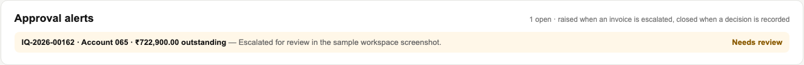
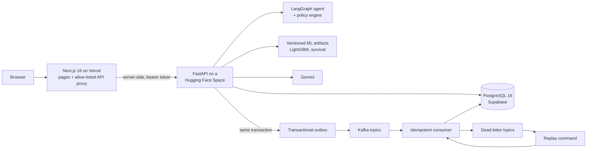
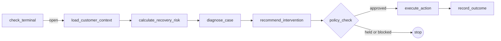
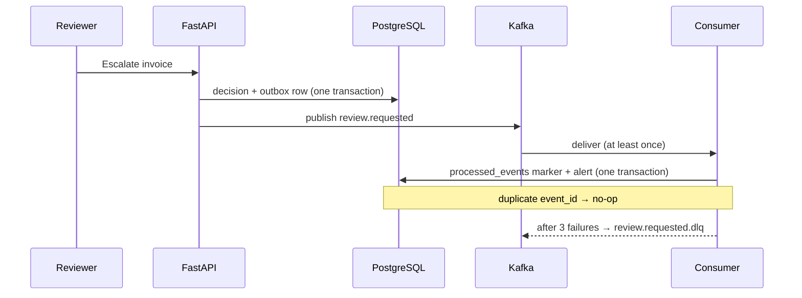

<div align="center">

# InvoiceIQ

**Receivables intelligence for B2B finance teams: see the cash behind every invoice, predict which ones will pay late, and review high-value recovery actions before execution.**

[](https://github.com/whizey/InvoiceIQ/actions/workflows/ci.yml)
[](https://github.com/whizey/InvoiceIQ/actions/workflows/deploy.yml)
[](https://github.com/whizey/InvoiceIQ/actions/workflows/security.yml)
[](LICENSE)

**[Open the live app →](https://invoiceiq-ai.vercel.app)** &nbsp;·&nbsp; [Watch the two-minute walkthrough](frontend/public/walkthrough/invoiceiq-walkthrough.webm) &nbsp;·&nbsp; [Read the docs](docs/PROJECT_OVERVIEW.md)


</div>

> The public workspace runs on **seeded, simulated invoices** (1,500 invoices across 97 companies), and the risk model was developed on a public B2B invoice-payment dataset. Open the sample workspace from the home page; no sign-up is needed. InvoiceIQ never moves money, and its forecasts are predictions, not guarantees.

### At a glance

| 1,500 | 6 | 0.706 | 7 | 760+ | ~0.4 s |
|:---:|:---:|:---:|:---:|:---:|:---:|
| sample invoices across 97 companies | dashboard KPIs that reconcile | test ROC-AUC of the late-payment model | policy rules between AI and action | automated backend tests | repeat-read latency on the live site |

---

## Contents

- [Why InvoiceIQ](#why-invoiceiq)
- [Try it in two minutes](#try-it-in-two-minutes)
- [What it does](#what-it-does)
- [Screens](#screens)
- [Architecture](#architecture)
- [One invoice, from flag to sign-off](#one-invoice-from-flag-to-sign-off)
- [AI with a human in the loop](#ai-with-a-human-in-the-loop)
- [The late-payment model](#the-late-payment-model)
- [Event pipeline on Kafka](#event-pipeline-on-kafka)
- [Security and tenancy](#security-and-tenancy)
- [Performance](#performance)
- [Technology](#technology)
- [Repository layout](#repository-layout)
- [Run it locally](#run-it-locally)
- [Configuration](#configuration)
- [Testing and quality](#testing-and-quality)
- [CI/CD and hosting](#cicd-and-hosting)
- [Documentation](#documentation)
- [Limits and roadmap](#limits-and-roadmap)

---

## Why InvoiceIQ

Companies that sell to other businesses on credit wait weeks or months to be paid. Finance teams usually track this in spreadsheets: they can't easily see how much money is at risk, which invoices are about to go late, or which customers need a nudge, and chasing everyone by hand is slow and inconsistent.

InvoiceIQ turns invoices and payments into one trustworthy picture of receivables, scores every open invoice for late-payment risk with an explanation, and runs a recovery workflow where AI proposes the next step but fixed rules and a person decide what actually happens.

## Try it in two minutes

1. Open **[invoiceiq-ai.vercel.app](https://invoiceiq-ai.vercel.app)** and choose **Explore the product**. You get a private session in the sample workspace; nothing you do is visible to anyone else.
2. **Analytics:** switch the date basis (posting, due, payment) and range (90D, 12M, all data). Every KPI and chart recalculates, and the totals always reconcile.
3. **Invoices:** search and sort the portfolio, and open an invoice to see its late-payment score and the factors behind it.
4. **Cases:** escalate a risky invoice. An approval alert appears within a second or two, delivered through Kafka.
5. **Approvals:** approve or reject it. The alert closes and the decision is recorded in the audit trail.
6. **Assistant:** ask "Which customers owe the most past 90 days?" by typing or speaking.

Want your own data instead? **Create workspace**, then import invoices from a CSV.

## What it does

| | Capability | Details |
|---|---|---|
| 📊 | **Receivables dashboard** | Six headline KPIs (invoiced, open receivables, overdue exposure, overdue share, collected, score coverage), invoiced vs collected over time, aging schedule, balance bridge, overdue by account, daily collections and upcoming dues. Date basis (posting, due, payment), grouping (day to year), ranges and a comparison cutoff. Totals reconcile and export to CSV. |
| 🔮 | **Late-payment prediction** | A LightGBM model scores every open invoice at posting time and explains each score with its top SHAP drivers. |
| 🤖 | **Policy-gated recovery agent** | A LangGraph workflow investigates a case and proposes an action; a deterministic policy engine allows, holds or blocks it; held actions wait in an approvals queue. |
| ✅ | **Approvals and alerts** | Escalations raise approval alerts through the Kafka pipeline; reviewers approve or reject, and every decision is audited. |
| 💬 | **Tool-calling assistant** | Ask about balances, ageing, monthly trends and DSO, a customer's payment record, what falls due soon, why an invoice looks risky, or "what if Acme pays?", by text or voice. Every figure in an answer is checked against what its tools returned. |
| 🏢 | **Multi-tenant workspaces** | Sign up, import invoices by CSV (validated), and work in an isolated workspace with roles (owner, admin, reviewer). |

## Screens

| Approvals | AI assistant | Approval alerts |
|---|---|---|
|  |  |  |

## Architecture



- **Two deployable units.** The web app serves pages and proxies a fixed allow-list of API routes; the browser never talks to the API or the database directly. The session token lives in an HTTP-only, `SameSite=Strict` cookie, and non-GET requests must come from the site's own origin.
- **Every business rule lives in the API.** The `identity` dependency resolves the session, loads the workspace and checks membership, and every query is filtered by `workspace_id`.
- **Events can be redelivered without duplicate effects.** A decision and its event commit in one transaction; Kafka carries the event; the consumer deduplicates on `event_id`.

More in [docs/ARCHITECTURE.md](docs/ARCHITECTURE.md) and the decision records in [docs/adr](docs/adr).

## One invoice, from flag to sign-off

The [end-to-end integration test](backend/tests/test_end_to_end_intelligence.py) follows a synthetic **₹12,00,000 invoice, five days overdue**:

1. **Ingest and score.** The invoice is stored with a late-payment score and its top five model drivers; overdue detection opens a recovery case.
2. **Investigate and propose.** The agent reviews invoice and customer evidence and proposes contacting the customer, recording its reasons and evidence references.
3. **Policy holds it.** The `high_value_review` rule fires at ₹10,00,000, so the action is held as `PENDING_APPROVAL`. No message is sent.
4. **A person signs off.** A scoped reviewer approves; the audit records `REVIEW_APPROVED`, the action becomes `EXECUTED` and a simulated message is recorded. Approving again returns `409 Conflict`, so it can never run twice.

## AI with a human in the loop



The language model **proposes**; plain, tested Python **decides**. The policy engine applies these rules in order, and each outcome is tagged so overrides can be audited:

| # | Rule | Outcome |
|---|---|---|
| 1 | Customer broke a promise to pay | Escalate to a person |
| 2 | ₹10,00,000 or more and 45+ days overdue | Escalate to a person |
| 3 | Case already escalated | No automated reminders or calls |
| 4 | Three reminders already sent | Escalate instead |
| 5 | Last reminder under 7 days ago | Wait |
| 6 | High-value reminder | Hold for human review |
| 7 | Otherwise | Allow the reminder |

Inputs are screened for prompt injection and model output is validated against a schema, as defence in depth; the policy engine is the actual safety boundary. Without an LLM key, a rule-based fallback keeps the workflow running. Details in [docs/BACKEND.md](docs/BACKEND.md).

### The receivables assistant

The portal assistant ([`finance_agent.py`](backend/app/agents/finance_agent.py)) is a read-only tool-calling agent rather than a single prompt stuffed with facts:

1. **Act.** The model chooses from read-only tools over the workspace's own invoices, dated payments, model scores and review decisions: portfolio summary, ageing, overdue accounts, invoice search (including a due-date window), invoice detail, review queue, monthly trend and DSO, customer profile, risk explanation, a payment scenario (`what_if_paid`), invoice notes (`get_notes`, and `search_notes`, TF-IDF over the workspace's own notes) and a calculator that accepts only arithmetic. Notes (customer messages, disputes, payment promises, internal remarks) are written on the invoice view; the model receives them as `<data>`, and any note that tries to instruct the assistant is withheld from it. Invoice numbers are matched whatever their format (case, spaces, `-`, `/`, `.`); one that matches nothing in the workspace is kept in the answer and marked "not found in your records", never removed. At most 5 model calls and 4 tool calls per step.
2. **Check.** Code extracts every figure from the answer, whether written as ₹15.2 lakh, 83% or "ninety-one percent", and matches it against the tool results at the precision written. An unmatched figure gets one repair round, then its sentence is removed; if the lead sentence goes, the user is told the answer could not be verified.
3. **Propose.** The model may suggest a review decision; code blocks paid invoices, escalations without a reason or before the due date, other workspaces' invoices and repeats. Allowed suggestions show an **Apply** button; nothing is saved until a person clicks it.
4. **Fall back.** `LLM_MODEL`, then each of `GEMINI_FALLBACK_MODELS`, then Groq if configured, then a rule-based answer. A rate-limited model is retried once when the delay is a few seconds, otherwise skipped by later requests until its quota window passes.

Workspace figures come from the dashboard's own calculation (`compute_portal_dashboard`) for the same period, so an answer always adds up to what the dashboard shows. Answers stream to the chat as progress steps ("Checking ageing…", "Checking every figure against your records…"); the text itself is only sent once its figures and suggestions have passed the checks. Written recommendations get the same rules as Apply suggestions.

Every model call, tool call, check and fallback is recorded in `assistant_traces` (metadata only, no question or answer text). With `LANGCHAIN_TRACING_V2` and `LANGCHAIN_API_KEY` set, each answer is also one **LangSmith** trace: the model calls, every tool call with its arguments and result, the figure and policy checks and any fallback, nested in order, with metadata to filter on (who answered, fallback used, figures checked and removed, latency). Customer-workspace traces carry structure and metadata only unless `LANGSMITH_LOG_CUSTOMER_CONTENT=true`; the illustrative showcase and eval fixture are sent in full, and recorded voice audio is never sent. The **reliability page** (`/assistant/reliability`) shows, per workspace, which model answered (main, backup or rules), how the figures fared (verified, fixed after a rewrite, trimmed), response times, and the evaluation results below. `python -m app.agents.check_providers` tests each model in the chain with one tool call.

### Note search: hybrid retrieval

`search_notes` ranks a workspace's notes two ways and merges them with reciprocal rank fusion ([`note_search.py`](backend/app/agents/note_search.py)): TF-IDF keywords with light stemming, and similarity of Gemini embeddings (`gemini-embedding-001`, 256 dimensions, stored per note and backfilled). A note counts as a semantic match above a cosine floor of 0.75; without an embedding key it is keyword-only. Measured on a hand-labelled benchmark of 28 notes and 25 queries ([`notes_retrieval_v1.json`](backend/tests/fixtures/notes_retrieval_v1.json): 7 keyword, 6 mixed, 7 paraphrase with no shared words, 5 unrelated), with cached embeddings so CI reruns it offline:

| Method | Recall@3 | MRR | Hit@1 | Recall@3: keyword / mixed / paraphrase | False matches per unrelated query |
|---|---|---|---|---|---|
| Keywords only | 0.65 | 0.72 | 0.70 | 1.00 / 0.92 / 0.07 | 0.6 |
| Meaning only | 0.90 | 0.88 | 0.80 | 0.86 / 1.00 / 0.86 | 0.2 |
| **Hybrid** | **0.90** | **0.89** | **0.80** | **1.00 / 1.00 / 0.71** | 0.6 |

Hybrid keeps every exact-term match (invoice numbers, "IFSC", "credit note"), which meaning alone misses, while lifting paraphrase recall from 0.07 to 0.71; meaning alone is better on pure paraphrases. The floor was chosen on this same benchmark, so these figures are optimistic for unseen notes; `gemini-embedding-2` scored lower and was not used. `python -m app.agents.retrieval_eval --sweep` reproduces the table.

### Measured accuracy

Live answers have no answer key, so accuracy is measured on a fixed set of 108 questions with hand-worked answers over an 11-invoice fixture ([`assistant_eval_v1.json`](backend/tests/fixtures/assistant_eval_v1.json)): core figures (30), tricky wording (35), multi-turn follow-ups (15), prompt-injection attempts including one planted in a stored review note (10), out-of-scope requests (5), policy cases (5) and invoice notes (8, including a planted instruction). Each model answers alone, with no fallback, three times. `gemini-3.6-flash` is not in the table: its free tier allows 20 requests a day per project, about 6 questions, so three runs would take weeks. An answer counts as correct only if it states every key figure, names what it must, contains nothing forbidden and lets no blocked suggestion through. Offline, CI checks every case's tool figures and the rule-based fallback on each change.

<!-- assistant-eval:start -->
| Model | Runs | Cases answered | Accuracy | Figures verified | Tool recall | Median / p95 time |
|---|---|---|---|---|---|---|
| `gemini-3.5-flash-lite` | 1 | 23 of 100 | 95.7% ± 0.0 | 100.0% ± 0.0 | 95.7% ± 0.0 | 3.0 s / 7.9 s |
| `openai/gpt-oss-120b` | 1 | 58 of 100 | 93.1% ± 0.0 | 91.4% ± 0.0 | 91.4% ± 0.0 | 2.7 s / 9.4 s |

| Model | core | followup | injection | tricky |
|---|---|---|---|---|
| `gemini-3.5-flash-lite` | 96% ± 0 | – | – | – |
| `openai/gpt-oss-120b` | 96% ± 0 | 100% ± 0 | 50% ± 0 | 92% ± 0 |

_In progress: free-tier quotas allow a few dozen questions per model per day, so the runs fill in over several days; cases answered so far: `gemini-3.5-flash-lite` 23, `openai/gpt-oss-120b` 58._

Fixture `assistant-eval-v3`, results as of 2026-10-22. Mean ± sample standard deviation across runs.
<!-- assistant-eval:end -->

The [nightly workflow](.github/workflows/assistant-eval-nightly.yml) resumes the runs on dedicated keys (`EVAL_GOOGLE_API_KEY`, `EVAL_GROQ_API_KEY` repository secrets) so the live site keeps its quota, stores raw answers on the `assistant-eval-results` branch and proposes the refreshed table on `chore/assistant-eval-results`. Locally: `backend/scripts/run_assistant_eval_daily.sh`.

## The late-payment model

| Metric | Validation (13,355 rows) | Chronological test (6,181 rows) |
|---|---|---|
| ROC-AUC | **0.714** | **0.706** |
| PR-AUC | 0.610 | 0.636 |
| Brier score (lower is better) | 0.241 | 0.281 |

- **Model:** LightGBM champion `b2b_v2:5a8417263da99809`, 14 behaviour-heavy features, trained on 34,437 invoices.
- **Stability:** a four-fold temporal backtest has a median ROC-AUC of 0.666 and no fold below random.
- **Calibration:** Platt scaling was tested and rejected because it lowered ranking quality, so raw scores are served.
- **Explanations:** every score comes with TreeSHAP contributions in log-odds.
- **Integrity:** artifacts are fingerprinted and verified at startup, so a changed model can't be served silently.
- **Provenance:** the frozen model was scored once on the test split for this report, with no refit or threshold tuning. That split had been examined during earlier development, so it is retrospective held-out evidence rather than a blind test.

The full record, with the split fingerprint and limitations, is in [docs/evaluations/model-risk-v1.json](docs/evaluations/model-risk-v1.json) and [docs/ML_MODELS.md](docs/ML_MODELS.md).

## Event pipeline on Kafka



| Guarantee | How |
|---|---|
| Nothing announced that didn't happen | Transactional outbox: the event row commits with the decision |
| No duplicate effects | `(consumer, event_id)` marker and the effect commit together; replays are no-ops |
| Late events can't overwrite newer state | Risk updates are latest-wins by `occurred_at` |
| Failures don't block the stream | 3 retries with backoff, then a dead-letter row and a `<topic>.dlq` message |
| Recoverable | `python -m app.events.replay` re-applies parked events after a fix |
| Survives broker data loss | An outbox reconciler re-applies published-but-unapplied events every 60 s |
| Never blocks the product | If no broker is reachable, the same handlers run in-process |

The hosted API starts a single-node Kafka 3.9 (KRaft) beside itself when available; event effects use the in-process fallback if the broker is unavailable. To try it locally with Redpanda and a web console, see [deploy/local-kafka](deploy/local-kafka/README.md). More in [docs/EVENT_PIPELINE.md](docs/EVENT_PIPELINE.md).

The [deduplication check](deploy/local-kafka/README.md) prints `first delivery: processed`, `second delivery: duplicate`, `approval alerts: 1`, and `dedupe markers: 1`. A poison event is parked in the database and published to `<topic>.dlq`; `python -m app.events.replay --dry-run` previews it before replay.

## Security and tenancy

- **Isolation:** every portal query is scoped to the caller's workspace; tests attempt cross-tenant reads and writes and expect them to fail. Visitors to the shared sample only ever see their own decisions.
- **Credentials:** scrypt password hashing with per-user salts and constant-time comparison; opaque `iqp_` session tokens stored only as SHA-256 digests, expiring after 8 hours and revocable.
- **Abuse limits:** account lockout after 5 failed sign-ins (30 s, doubling to 15 minutes, identical for unknown emails so accounts can't be enumerated); throttled sign-ups; assistant capped at 8 requests a minute; request-size limits.
- **Browser hardening:** HSTS, a content security policy that blocks framing by other sites, plugins and form hijacking, `nosniff`, a strict referrer policy and a microphone-only permissions policy.
- **Supply chain:** gitleaks over the full history, `pip-audit`, `npm audit`, Dependabot, and a privacy check that blocks private files from the repository.

Details in [docs/SECURITY_AND_PRIVACY.md](docs/SECURITY_AND_PRIVACY.md).

## Performance

Measured against the live site after the latest release:

| Request | Before | After |
|---|---|---|
| Authenticated read, repeated | 1.7–2.3 s | **~0.4 s** |
| Dashboard, same filters again | 1.6–2.0 s | **~0.4–0.5 s** |
| 20 concurrent clients | 7% errors | **0 errors** |

Reads reuse a short-lived session lookup and a versioned per-workspace cache that every write invalidates, so numbers are never stale. The connection pool is bounded to fit the hosted database pooler. A reusable load test lives in [scripts/loadtest](scripts/loadtest/run.py).

## Technology

| Area | Tools |
|---|---|
| Frontend | Next.js 16 (App Router), React 19, TypeScript, ESLint |
| Backend | Python 3.12, FastAPI, Uvicorn, SQLAlchemy 2 (async), asyncpg, Pydantic, Alembic (20 migrations) |
| Data | PostgreSQL 16 (Supabase), Redis (optional distributed lock), Git LFS for model artifacts |
| ML | LightGBM, XGBoost, scikit-learn, scikit-survival, SHAP, pandas, NumPy |
| AI | LangGraph, LangChain, Google Gemini, Sarvam (Hinglish speech), browser Web Speech API |
| Events | Apache Kafka 3.9 (KRaft), aiokafka, Redpanda (local), transactional outbox |
| Quality | pytest, coverage gate (80%), Playwright, Node test runner, Ruff, gitleaks, pip-audit, npm audit, Dependabot |
| Delivery | Docker, Docker Compose, GitHub Actions, Vercel, Hugging Face Spaces |

The full inventory with versions and reasons is in [docs/TECH_STACK.md](docs/TECH_STACK.md).

## Repository layout

```text
InvoiceIQ/
├── backend/                 FastAPI app, ML, agents, events, migrations, tests
│   ├── app/api/             HTTP routes (portal, recovery, ML, health)
│   ├── app/agents/          LangGraph workflow, prompts, guardrails
│   ├── app/services/        policy engine, review gate, dashboards, risk engine
│   ├── app/events/          outbox, Kafka publisher, consumer, reconciler, replay
│   ├── app/ml/              training, evaluation, calibration, serving, artifacts
│   ├── alembic/             database migrations
│   └── tests/               760+ tests against a disposable PostgreSQL
├── frontend/                Next.js app, API proxies, reference dashboard, tests
├── deploy/                  Hugging Face Space packaging, local Kafka stack
├── infra/                   loopback-only staging Compose rehearsal
├── docs/                    guides, decision records, evaluation reports, images
├── scripts/                 build, verification and load-test scripts
└── .github/workflows/       CI, security, deploy
```

## Run it locally

**Requirements:** Docker Desktop, Python 3.12+, Node.js 22 and npm.

```sh
git clone https://github.com/whizey/InvoiceIQ.git
cd InvoiceIQ
git lfs pull          # model artifacts
./run.sh              # local database, migrations, API and web app
```

`./run.sh` uses a local development database. It is **not** the integration-test database: never point seeds or test fixtures at a database holding data you care about. Manual startup and every environment variable are described in [backend/README.md](backend/README.md) and [docs/OPERATIONS.md](docs/OPERATIONS.md).

Gemini, email and voice keys are optional. Without them, rule-based reasoning and simulated communication keep every flow working.

To run the event pipeline against a real broker:

```sh
docker compose -f deploy/local-kafka/docker-compose.yml up -d   # Redpanda + console on :8080
cd backend && python -m scripts.send_sample_events && python -m app.events.consumer
```

## Configuration

All settings are environment variables; every optional integration switches itself off cleanly when its variable is missing. The full list, with defaults, is in [backend/.env.example](backend/.env.example).

| Variable | What it controls | Default |
|---|---|---|
| `DATABASE_URL` | PostgreSQL connection (asyncpg) | required |
| `ENV` | `local`, `staging` or `production`; hosted modes tighten auth on private endpoints | `local` |
| `INVOICEIQ_PORTAL_ENABLED` / `INVOICEIQ_PORTAL_SHOWCASE` | Turn on the multi-tenant portal and the shared sample workspace | off |
| `GOOGLE_API_KEY` | Gemini for the agent, the assistant and transcription | rule-based fallback |
| `LLM_MODEL` | Primary model | `gemini-3.6-flash` |
| `GEMINI_FALLBACK_MODELS` | Comma-separated Gemini models tried in order when the primary is rate limited; each has its own free quota. `none` disables | `gemini-3.5-flash-lite` |
| `GROQ_API_KEY`, `GROQ_MODEL` | Groq's free tier as the next fallback | off |
| `SARVAM_API_KEY` | Hinglish speech in and out for the voice-call flow | off |
| `RESEND_API_KEY`, `RESEND_FROM` | Real reminder email | simulated |
| `KAFKA_BOOTSTRAP_SERVERS` | External Kafka broker (TLS and SASL supported) | in-process delivery |
| `EMBEDDED_KAFKA` | Start single-node Kafka beside the API on the hosted Space | `true` |
| `OUTBOX_DISPATCH_ENABLED` | Publish outbox rows to the broker | off |
| `REDIS_URL` | Distributed lock for the recovery workflow | in-process lock |
| `SCHEDULER_ENABLED` | Background loop that opens and cycles overdue cases | off |
| `REGISTRATION_LIMIT_PER_10_MIN` | Ceiling on new sign-ups | `60` |
| `IDENTITY_CACHE_SECONDS` | How long a read reuses its session lookup | `15` |
| `DB_POOL_SIZE` / `DB_MAX_OVERFLOW` / `DB_POOL_TIMEOUT` | Database connection pool, sized for hosted poolers | `5` / `3` / `20` s |
| `METRICS_ENABLED`, `METRICS_TOKEN` | Private Prometheus endpoint, token-protected outside local mode | off |
| `PUBLIC_READ_ONLY` | Block every write on a public read-only deployment | off |

The web app needs only `INVOICEIQ_API_URL`, the server-side address of the API. No secret ever reaches the browser.

## Testing and quality

```sh
# backend: needs the disposable database from backend/docs/BACKEND_TEST_RUNNER.md
cd backend && ruff check app tests && ./scripts/run_full_tests.sh --coverage

# frontend
cd frontend && npm ci && npm run lint && npm run typecheck && npm test && npm run build
```

- **Backend:** 760+ tests across about 110 files run against a real PostgreSQL. They cover tenant isolation, sessions and lockout, policy rules, the review gate, reconciliation of dashboard totals, the event pipeline (duplicates, late events, retries, dead letters, broker loss) and ML artifact integrity. CI enforces 80% coverage.
- **Migrations:** CI applies them up, down to base, and up again.
- **Frontend:** unit and contract tests for the dashboard, CSV import and financial consistency, plus Playwright journeys against a production build.
- **Safety:** test connections are checked against the disposable database's identity before any fixture runs.

See [docs/TESTING.md](docs/TESTING.md).

## CI/CD and hosting

| Stage | What runs |
|---|---|
| CI | Ruff, backend tests with coverage, migrations up/down/up, ESLint, TypeScript, frontend tests and build, Docker images, staging Compose validation |
| Security | full-history gitleaks, privacy check, `pip-audit`, `npm audit` |
| AI checks | offline agent-safety cases and model contract checks |
| Deploy | API packaged to the Hugging Face Space, web app to Vercel, then a smoke test of the live site, a sample session and the main data endpoints |

| Component | Host |
|---|---|
| Web app | Vercel |
| API, consumer and Kafka | Hugging Face Space (one container) |
| Database | Supabase PostgreSQL (session pooler) |

See [docs/CICD_AND_DEPLOYMENT.md](docs/CICD_AND_DEPLOYMENT.md) and [docs/DEPLOY_SAAS.md](docs/DEPLOY_SAAS.md). `infra/compose.deploy.yml` is a loopback-only staging rehearsal, not a public deployment.

## Documentation

| Guide | Covers |
|---|---|
| [Project overview](docs/PROJECT_OVERVIEW.md) | The problem, the users and the product |
| [Architecture](docs/ARCHITECTURE.md) | Components, request path, data model, trade-offs |
| [Backend](docs/BACKEND.md) | Portal, agent workflow, policy engine, review gate |
| [Frontend](docs/FRONTEND.md) | Pages, proxies, reference dashboard |
| [Event pipeline](docs/EVENT_PIPELINE.md) | Outbox, Kafka, consumer, dead letters, replay |
| [ML models](docs/ML_MODELS.md) | Features, evaluation, calibration, explanations |
| [API reference](docs/API_REFERENCE.md) | Every endpoint |
| [Security and privacy](docs/SECURITY_AND_PRIVACY.md) | Threat model and controls |
| [Testing](docs/TESTING.md) | Suites and how to run them |
| [Workflows](docs/WORKFLOWS.md) | End-to-end user journeys |
| [Operations](docs/OPERATIONS.md) | Release steps, limits, recovery |
| [Decision records](docs/adr) | Outbox, policy gate, embedded Kafka |

## Limits and roadmap

| Today | Next |
|---|---|
| Free hosting serves a handful of simultaneous users comfortably | Larger instance or horizontal scaling |
| Caches and rate limits are per process | Shared Redis cache and limiter |
| Free-tier model quotas cap assistant traffic; each answer takes several model calls (about 3 s on Gemini Flash-Lite) | Paid tier or more fallback models |
| Single-node Kafka with ephemeral storage (covered by the outbox and reconciler) | Managed, replicated cluster; the configuration already supports it |
| Policy thresholds are global constants | Per-workspace policy settings |
| No email verification or password reset | Both, once an email sender is configured |
| Reminder email is simulated on the hosted site | Real delivery through the existing email integration |

## License

[MIT](LICENSE). Contributions are welcome; see [CONTRIBUTING.md](CONTRIBUTING.md) and [CHANGELOG.md](CHANGELOG.md).
