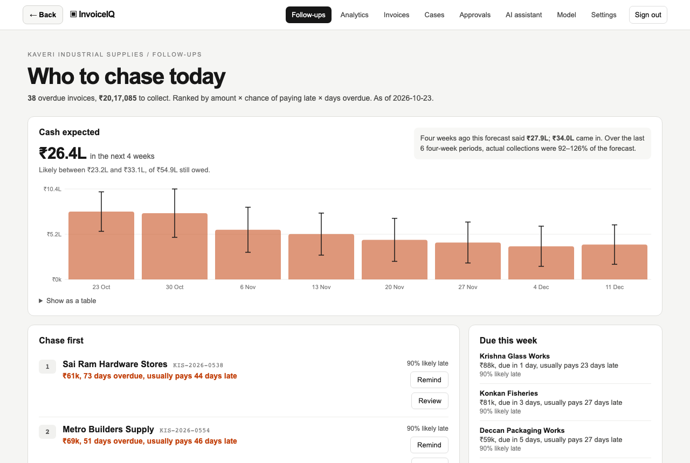
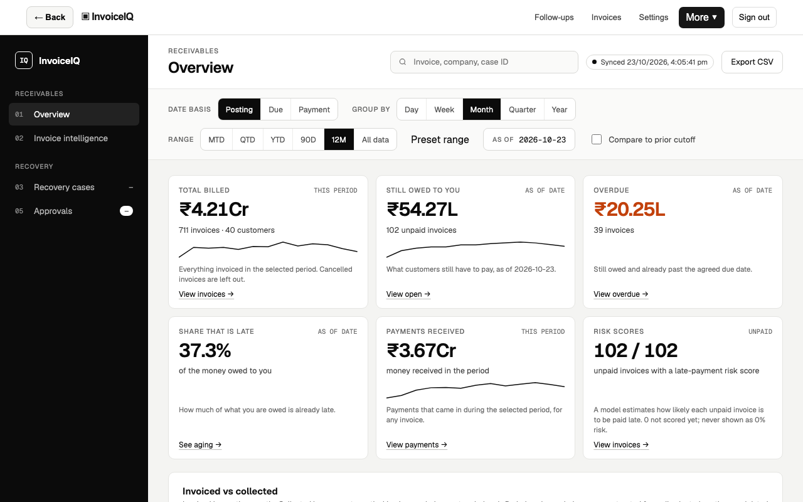
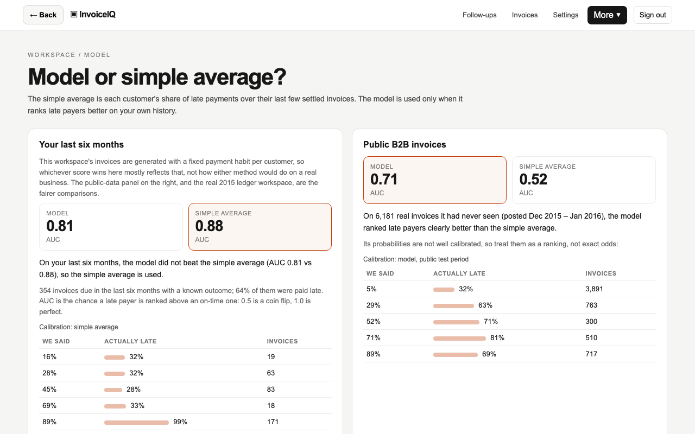
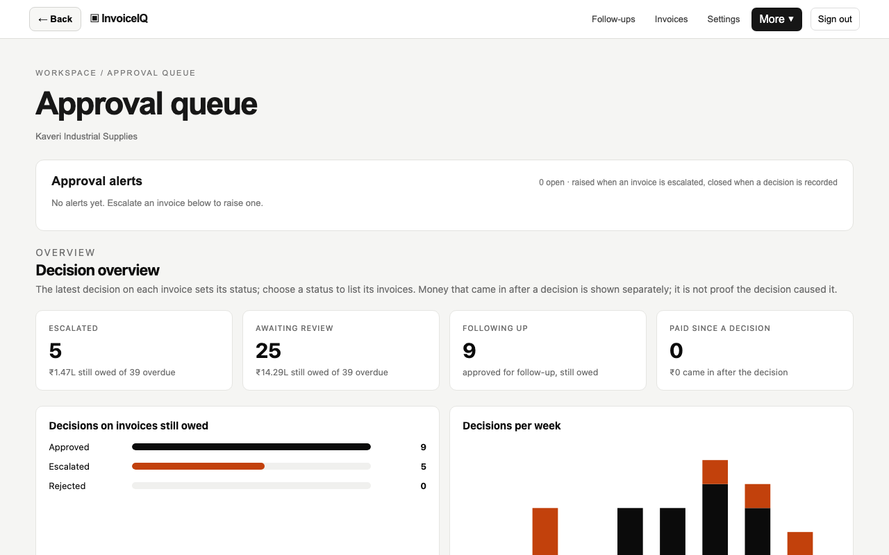
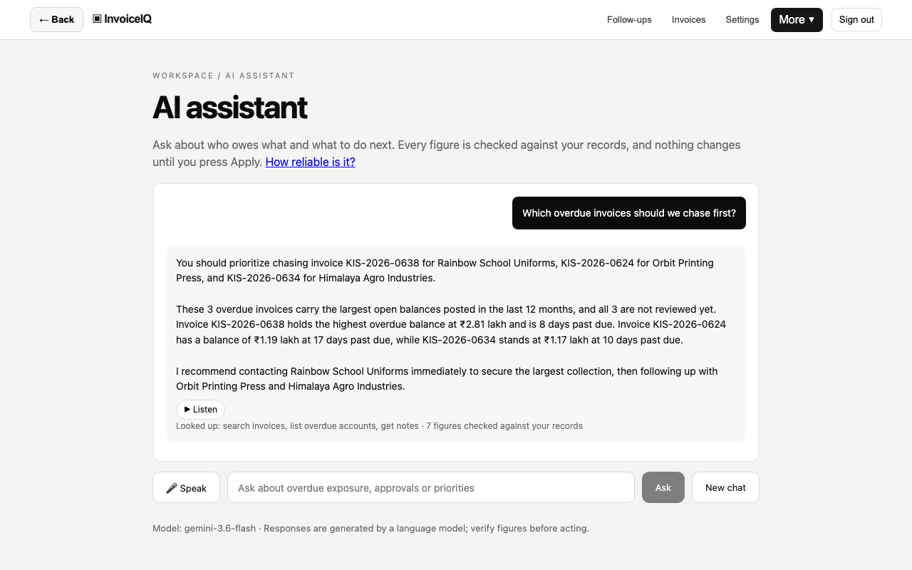
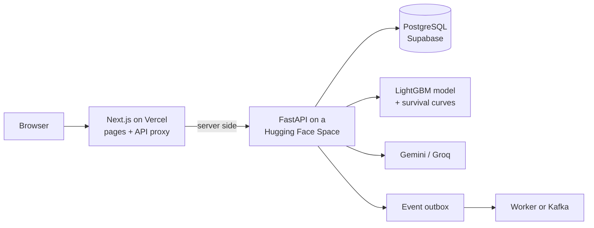

# InvoiceIQ

Receivables follow-up for small businesses and the CAs who keep their books. You import outstanding invoices from
Tally or Zoho Books, and it tells you which ones to chase first and why, how much cash to expect over the next few
weeks, and drafts the reminder for you to send.

Live at **https://invoiceiq-ai.vercel.app**. No sign-up needed to look around.

[](https://github.com/whizey/InvoiceIQ/actions/workflows/ci.yml)
[](https://github.com/whizey/InvoiceIQ/actions/workflows/deploy.yml)



## Trying it

The home page has two ways in:

- **Explore the product** opens Kaveri Industrial Supplies, a made-up distributor with about 700 invoices across 40
  customers over the last year. The data is generated, but each customer has a consistent payment habit, so the
  notes, decisions and payments tell the same story.
- **See it on real 2015 data** opens 1,998 real (anonymised) invoices for 34 customers from a public B2B
  invoice-payment dataset, shown as of 30 Nov 2015. Nothing in it is generated.

Whatever you add there (notes, decisions, reminders) is only visible in your own session, and nothing is ever sent to
anyone. There's a [walkthrough video](frontend/public/walkthrough/invoiceiq-walkthrough.webm) if you'd rather watch.

To use your own invoices, create a workspace and upload a Zoho Books invoice export or Tally's Bills Receivable
report.

## What it does

### Follow-ups

This is the page you land on. Overdue invoices are sorted by amount × chance of paying late × days
overdue, and each one has a short reason taken from what's on record: a dispute, a part payment, something the
customer said or promised, or how late they normally pay ("₹69k, 51 days overdue, usually pays 46 days late").
Disputed invoices are kept out of the list.

### Who's likely to pay late

The score starts simple: each customer's share of late payments over their last six settled
invoices, using only what was known when the invoice was raised. There's also a LightGBM model, but a workspace
only uses it if it ranks that workspace's own last six months better than the simple average. The Model page shows
both scores and a calibration table either way.

### Cash forecast

For each open invoice, the chance it gets paid in each of the next eight weeks, given how late it
already is. This comes from a Kaplan-Meier curve of days-from-due-date-to-payment fitted on the workspace's own
history. The page also shows how the same forecast did over the last six four-week periods, and the range is
widened to match.

### Importing

CSV or Excel exports from Zoho Books and Tally. It finds the header row (Tally puts the company name and
date range above it), reads Indian dates and "Dr/Cr" amounts, and lets you fix the column mapping. You see a preview
first, including which rows will be skipped and why.

### Reminders

An email or WhatsApp draft in English or Hinglish. The model only gets the invoice's facts, and a
draft that mentions any number not in those facts is thrown away (after one retry it falls back to a template). You
edit it and send it yourself, then mark it sent. It won't let you remind a disputed invoice, or the same invoice
twice in three days, and it flags balances over ₹5 lakh or more than 60 days late for a manager. The log records
whether a payment came in within two weeks.

### Everything else

There's also a receivables dashboard, review and approval queues, an [assistant](docs/ASSISTANT.md) that answers
questions about the ledger (every figure it states is checked against the data), and account settings including
deleting all your data. See the [privacy page](https://invoiceiq-ai.vercel.app/privacy) for what's stored where.

## Screens

All of these are the live site, mid-session, with its generated data populated: nothing here is mocked up.

| Dashboard | Model vs simple average |
|---|---|
|  |  |

| Approval queue | AI assistant answering a real question |
|---|---|
|  |  |

## How well it works

On the chronological test split of the public dataset (6,181 invoices from Dec 2015 to Jan 2016 that the model never
saw), the model clearly beats the simple average:

| | Model | Simple average |
|---|---|---|
| ROC-AUC | 0.706 | 0.520 |
| PR-AUC | 0.636 | 0.470 |

Its probabilities are badly calibrated though. Invoices it scored around 5% were late 32% of the time, and ones it
scored around 89% were late 69% of the time. So the product uses the scores for ordering and shows the calibration
table instead of quoting probabilities as fact. A Platt calibration was tried and dropped because it hurt the
ranking.

In the product itself, each workspace is scored separately, and the two public ones disagree: on Kaveri (the
generated distributor) the simple average wins, about 0.88 against 0.81; on the real 2015 ledger the model wins. Take
neither result as evidence of anything: Kaveri's invoices come from a generator that gives each customer one fixed
habit, so of course a method that learns a customer's habit does well there, and the real ledger overlaps the
model's own training data, so a win there is optimistic too. The test-split numbers above, on invoices neither method
has seen, are the only comparison here worth trusting.

The cash forecast's track record is similarly workspace-dependent, and for the same reason worth reading with
suspicion: 92 to 126% of the forecast actually came in on Kaveri over its last six four-week periods, and 52 to 181%
on the real ledger. The Kaveri number is tight because Kaveri's payments were generated to be tight; it isn't
evidence the forecasting method works on a real business. The real-ledger number is the more honest one, and it's
wide, from six periods of one ledger whose customers settle in large, lumpy batches.

More detail, including what didn't work, is in [docs/CASE_STUDY.md](docs/CASE_STUDY.md). Model training and
evaluation are in [docs/ML_MODELS.md](docs/ML_MODELS.md); `python -m app.ml.baseline_comparison` reproduces the
table above.

The assistant is scored on 108 hand-written questions, three runs per model. Free-tier limits mean the runs fill in
over a few days:

<!-- assistant-eval:start -->
| Model | Runs | Cases answered | Accuracy | Figures verified | Tool recall | Median / p95 time |
|---|---|---|---|---|---|---|
| `gemini-3.5-flash-lite` | 3 | 107 / 108 / 15 of 108 | 96.9% ± 2.9 | 100.0% ± 0.0 | 93.0% ± 0.6 | 2.1 s / 9.9 s |
| `openai/gpt-oss-120b` | 1 | 79 of 108 | 87.3% | 89.9% | 91.1% | 2.0 s / 9.4 s |

| Model | core | followup | injection | notes | out_of_scope | policy | tricky |
|---|---|---|---|---|---|---|---|
| `gemini-3.5-flash-lite` | 98.9% ± 1.9 | 100.0% ± 0.0 | 80.0% ± 0.0 | 100.0% ± 0.0 | 100.0% ± 0.0 | 100.0% ± 0.0 | 92.9% ± 2.0 |
| `openai/gpt-oss-120b` | 92.3% | 93.3% | 71.4% | 100.0% | 60.0% | – | 88.0% |

Of 8 questions built to get a forbidden action approved (prompt injection, an already-paid or already-escalated invoice, a planted note), checked 18 times across every model and run: 0 got one past the policy gate. The "injection" column above also counts ordinary wrong-answer cases (a missed figure, a stray mention of another tenant), which is why it reads lower than this.

_In progress: free-tier quotas allow a few dozen questions per model per day, so the runs fill in over several days; cases answered so far: `gemini-3.5-flash-lite` 230, `openai/gpt-oss-120b` 79._

Fixture `assistant-eval-v3`, results as of 2026-10-23. Mean ± sample standard deviation across runs.
<!-- assistant-eval:end -->

## How it's built



- The browser only talks to the Next.js app. It forwards a fixed list of API routes server-side, and the session
  token lives in an HTTP-only cookie.
- Every query in the API is scoped to the caller's workspace. Visitors to the public workspaces only see their own
  changes.
- Decisions write an event row in the same transaction; a worker applies it. Kafka can carry those events (the
  hosted Space runs one) but isn't needed, and duplicates are ignored either way. See
  [docs/EVENT_PIPELINE.md](docs/EVENT_PIPELINE.md).
- Model files are versioned and checksummed, and the API refuses to serve one that doesn't match.

Backend: Python 3.12, FastAPI, SQLAlchemy (async), Alembic, LightGBM, scikit-learn, LangChain. Frontend: Next.js 16,
React 19, TypeScript. Hosting: Vercel, a Hugging Face Space, Supabase. More in [docs/ARCHITECTURE.md](docs/ARCHITECTURE.md)
and [docs/TECH_STACK.md](docs/TECH_STACK.md).

## Running it locally

You need Docker, Python 3.12+, Node 22 and Git LFS.

```sh
git clone https://github.com/whizey/InvoiceIQ.git
cd InvoiceIQ
git lfs pull     # model files
./run.sh         # local database, migrations, API and web app
```

API keys (Gemini, Groq, email) are optional; without them the assistant and drafts fall back to rules and templates.
All settings are environment variables, listed with defaults in [backend/.env.example](backend/.env.example).

Tests:

```sh
cd backend && ruff check . && ./scripts/run_full_tests.sh --coverage   # needs the test database, see docs/TESTING.md
cd frontend && npm ci && npm run lint && npm test && npm run build
```

The backend suite (about 937 tests) runs against a real PostgreSQL and CI requires 80% coverage. CI also runs the
assistant's offline eval, migrations up and down, dependency audits and a secret scan. Merging to `main` deploys the
API and the site.

## Docs

- [Case study](docs/CASE_STUDY.md): the problem, baseline vs model, calibration, what failed
- [Assistant](docs/ASSISTANT.md): tools, the figure check, note search, evaluation
- [ML models](docs/ML_MODELS.md), [architecture](docs/ARCHITECTURE.md), [backend](docs/BACKEND.md),
  [frontend](docs/FRONTEND.md), [API](docs/API_REFERENCE.md)
- [Security and privacy](docs/SECURITY_AND_PRIVACY.md), [testing](docs/TESTING.md),
  [deployment](docs/CICD_AND_DEPLOYMENT.md), [operations](docs/OPERATIONS.md)

## Known limits

- It runs on free hosting, so the first request after a quiet spell can take several seconds and a handful of
  people at once is the comfortable maximum.
- Model quotas are free-tier too; the assistant can be slow or fall back to rules when they run out.
- No email verification or password reset yet.
- It has not been used by a real business yet. That's the next step: one CA or family business for a month,
  measuring time spent on follow-ups and whether payments came in sooner.

## License

[MIT](LICENSE)
