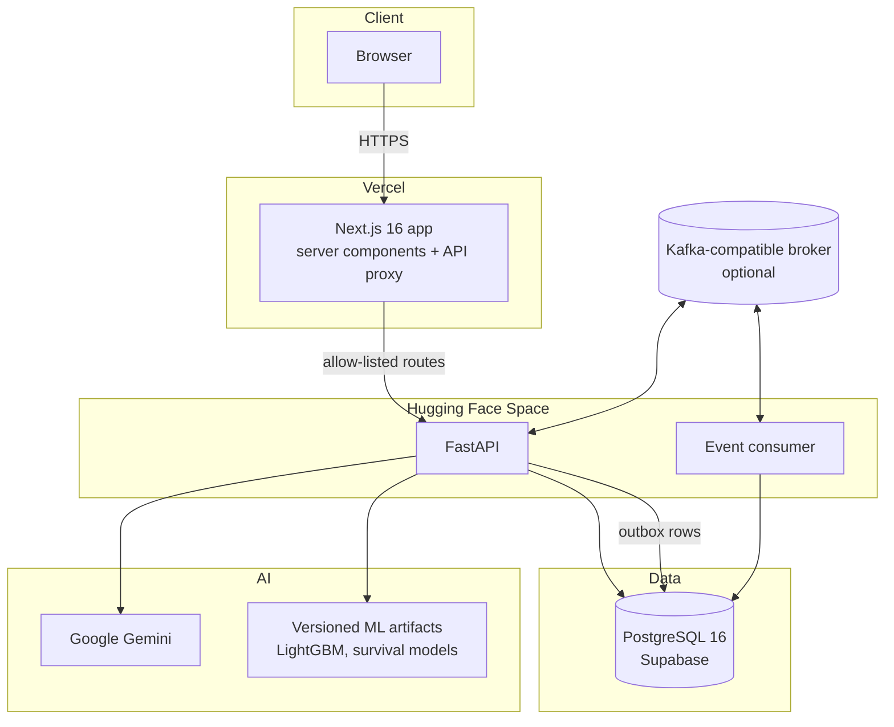

# Architecture

## System context

There are two deployable units. The **web app** serves pages and proxies API calls. The **API** holds every business rule. Nothing in the browser can reach the database or the API's private routes.

## The request path

1. The browser requests a page or calls `/api/portal/...` on the Next.js app.
2. The Next.js catch-all route checks the path against an allow-list, checks the request `Origin`, and reads the session token from an HTTP-only cookie.
3. It forwards the call to FastAPI with the token as a bearer credential.
4. FastAPI's `identity` dependency looks up the session, loads the workspace, verifies membership (for customer workspaces) and returns a scoped context. Every query that follows is filtered by that workspace.
5. Read-heavy endpoints (overview, recovery summary, dashboard) use a 30-second per-workspace cache. Any write to a workspace bumps its version so the next read is fresh.

## Layers inside the backend

| Layer | Folder | Responsibility |
|---|---|---|
| API | `backend/app/api/` | HTTP routes, request validation, response shapes |
| Core | `backend/app/core/` | Config, database session, auth and scoping helpers, request limits, observability, locks |
| Services | `backend/app/services/` | Business logic: policy engine, review gate, risk engine, dashboard builders, recovery summary |
| Agents | `backend/app/agents/` | LangGraph workflow, prompts, guardrails, LLM client |
| ML | `backend/app/ml/` | Training, evaluation, calibration, serving and drift monitoring for the models |
| Events | `backend/app/events/` | Outbox, publishers, consumer, handlers, in-process delivery, topics |
| Models | `backend/app/models/` | SQLAlchemy tables |
| Tools | `backend/app/tools/` | Email, voice speech I/O, read-only knowledge and query helpers |
| Seed | `backend/app/seed/` | Deterministic sample data and dataset loaders |

## Data model

29 tables across five groups (Alembic manages 20 migrations):

- **Customer portal:** `portal_workspaces`, `portal_users`, `portal_memberships`, `portal_sessions`, `portal_invoices`, `portal_payments`, `portal_case_events`
- **Legacy recovery domain:** `companies`, `contacts`, `invoices`, `payments`, `payment_events`, `recovery_cases`, `recovery_actions`, `agent_decisions`, `policy_decisions`, `promise_to_pay`, `communication_logs`, `audit_logs`
- **Analytics and ML provenance:** `analytics_history_state`, `invoice_state_snapshots`, `case_state_snapshots`, `inference_records`, `dataset_imports`, `offline_evaluations`
- **Events:** `outbox_events`, `processed_events`, `case_risk_latest`, `approval_alerts`, `dead_letter_events`

Design choices worth knowing:
- Portal records are tenant-scoped by `workspace_id`, and foreign keys cascade on workspace deletion.
- Sessions store only a SHA-256 digest of the token, never the token itself.
- Review events for the sample workspace carry an `actor_scope` (the visitor's session digest) so one visitor's decisions never appear to another. A shared `showcase-baseline` scope provides illustrative history for everyone.
- Payments are a dated ledger, so collections can be reported by day.

## Two deliberately separate API surfaces

The repository holds a **legacy single-company recovery API** (`/companies`, `/invoices`, `/recovery-cases`, `/dashboard`, `/ml`) and the **multi-tenant portal API** (`/portal`). A guard middleware denies the legacy routes on a public portal deployment, because portal identities must never grant access to the older single-workspace API.

## Design decisions and trade-offs

| Decision | Why | Trade-off |
|---|---|---|
| Deterministic policy gate between the AI and any action | Language models can be wrong or manipulated; rules are testable and auditable | Policy thresholds are module constants today; making them configurable per segment is future work |
| Transactional outbox for events | A decision and its event commit together or not at all, so nothing is announced that did not happen | At-least-once delivery, so consumers must deduplicate (they do) |
| Same handlers for broker and in-process delivery | The product behaves identically with or without Kafka | Without a broker, effects are applied inline after commit rather than asynchronously |
| Short-lived read cache with write invalidation | Cuts repeated aggregate queries | Cache is per process; scaling to several API instances would need a shared cache |
| Static reference dashboard in an iframe, fed by a data adapter | Preserves a reviewed visual design while data stays live | The iframe auto-sizes and hides its own sidebar on small screens |
| Artifact fingerprinting for models | Prevents silently serving a changed model | Artifacts live in Git LFS and must be fetched in CI and on deploy |

## Observability

Structured JSON logs carry a per-request id, bound through every layer. Optional Prometheus metrics are exposed at an internal path protected by a token. Optional LangSmith tracing of the agent workflow is off by default. Agent node spans can be persisted and are private to a company.

See also: [BACKEND.md](BACKEND.md), [EVENT_PIPELINE.md](EVENT_PIPELINE.md), [SECURITY_AND_PRIVACY.md](SECURITY_AND_PRIVACY.md).
