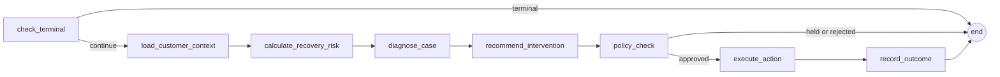

# Backend

FastAPI application in `backend/app`. This page explains how it works; the endpoint list is in [API_REFERENCE.md](API_REFERENCE.md).

## Multi-tenant customer portal

Implemented in `app/api/portal.py`.

### Accounts and sessions
- **Register:** requires a 12 to 256 character password. A user, a customer workspace and an `owner` membership are created together.
- **Passwords:** hashed with scrypt (`n=2^14, r=8, p=1`) and a random 16-byte salt, compared in constant time.
- **Sessions:** the client receives an opaque token starting `iqp_`. Only its SHA-256 digest is stored, sessions expire after 8 hours and can be revoked.
- **Sign-in throttling:** `app/core/login_throttle.py` locks an account after 5 failed attempts (30 seconds, doubling to a 15-minute cap). It is keyed by email, treats unknown emails identically, and refuses locked attempts before hashing the password.
- **Roles:** `owner`, `admin` and `reviewer`. Imports and scoring need owner or admin; recording a decision needs owner, admin or reviewer.

### Workspaces
- **Customer workspaces** hold the company's own invoices and payments.
- **The showcase workspace** is a single shared, read-mostly set of 1,500 illustrative invoices. Visitors get a session without an account. Decisions they record are tagged with their session scope, so they only see their own. A shared baseline of illustrative history is layered under every visitor's view.
- Isolation is enforced in the `identity` dependency and in every query's `workspace_id` filter. Tests exercise cross-tenant access.

### Data in and out
- **CSV import:** up to 250 invoices per upload. The server rejects duplicate invoice numbers, out-of-order dates (issue, posting, due), overpayment and paid invoices without a payment date. A dated payment ledger row is created for each paid invoice.
- **Invoice list:** search by number or counterparty (with safe wildcard escaping), five sort orders, pagination up to 100 per page.
- **Export:** the dashboard can be exported as CSV, with spreadsheet-formula neutralisation (cells starting with `=`, `+`, `-`, `@` are prefixed).

### Dashboard and analytics
- `GET /portal/dashboard` returns the data for the reference dashboard: invoiced vs collected, aging, a balance bridge, recovery pipeline, overdue by account, daily collections and upcoming dues. The selection controls (period, comparison, filters) are validated by a `DashboardSelection` model.
- `GET /portal/overview` returns headline totals, the first 100 invoices and recent actions.
- `GET /portal/recovery-summary` returns recovery KPIs, a status breakdown by count and amount, and eight weeks of decisions. The status of an invoice is its **latest** decision; `RESET` returns it to unreviewed.
- Read endpoints use a 30-second per-workspace cache, invalidated on every decision, import and scoring run.

### Decisions and alerts
Recording a decision (`APPROVE`, `REJECT`, `ESCALATE`, `RESET`) writes the decision and a domain event in one transaction. See [EVENT_PIPELINE.md](EVENT_PIPELINE.md). `GET /portal/alerts` returns the approval alerts for the current scope.

### AI assistant and voice
- `POST /portal/assistant` takes a question and up to six turns of history. The server builds a compact set of **workspace facts** (totals, aging, top overdue invoices, recovery status) and sends them with a system prompt requiring plain-language, grounded answers. It is limited to 8 requests per minute per session.
- The model is Gemini with a fast model for latency and a fallback if the first call fails. Responses are parsed from content blocks so thinking text is never shown.
- `POST /portal/transcribe` converts an uploaded audio clip to text with Gemini; the browser uses on-device speech recognition first and falls back to this endpoint.

### Risk scoring in the portal
`POST /portal/score` scores a workspace of up to 2,000 invoices **at posting time**: only information available before each invoice's posting date feeds its features, which avoids leaking future payments into the score. Stored scores carry the champion model's version and a fingerprint of its artifacts.

## The recovery workflow (agents)

Implemented in `app/agents/graph.py` with LangGraph. The graph:

- **Context and risk:** loads the case, history and promises; scores risk with the deterministic risk engine and the payment-risk model.
- **Diagnosis and recommendation:** a language model (Gemini) reasons about the situation and proposes an action. If no model key is configured, a rule-based fallback produces the proposal, so the workflow still runs.
- **Guardrails:** inputs are screened for prompt-injection phrases, context is size-limited, and the model's output is validated against a schema. These are defence in depth; the policy engine is the security boundary.
- **Policy check:** see below. Held actions are stored as `PENDING_APPROVAL` and the workflow stops.
- **Execute and record:** approved actions run through tools (email, payment link, promise tracking, escalation, voice call). Outcomes, audit rows and events are written.
- **Agent spans** can be persisted per node for traceability and are private to the company.

### The policy engine
`app/services/policy_engine.py` is plain Python against fixed thresholds. Order of rules:

1. **Broken promise to pay:** forces `ESCALATE`.
2. **High value and significantly overdue** (amount at or above ₹1,000,000 and 45 or more days overdue): forces `ESCALATE`.
3. **Already escalated:** automated reminders and new voice calls are suppressed (a human owns the case).
4. **Reminder cap:** after 3 reminders, escalate instead.
5. **Cooldown:** at least 7 days between reminders, otherwise `WAIT`.
6. **High-value reminder:** requires human review.
7. Otherwise the reminder is approved.

Each outcome records a machine-readable rule tag so overrides can be aggregated on the oversight dashboard.

### Human review
`app/services/review_gate.py` holds actions the policy engine marks for review. Nothing is sent until `approve()` runs; `reject()` records the refusal. Both write an audit row with actor `HUMAN`.

### Voice call sample
A human-triggered Hinglish voice-call flow: Sarvam handles speech in and out, a language model decides what to say and what to propose, and the same policy engine decides what actually happens. The scheduler never places calls.

### Scheduler
An optional in-process loop (`SCHEDULER_ENABLED`) detects overdue invoices, opens cases and cycles open cases. Escalated cases are skipped, and a distributed lock (Redis, or in-process) prevents two triggers from double-executing.

## Cross-cutting concerns

| Concern | Where | Notes |
|---|---|---|
| Configuration | `core/config.py` | Typed settings from the environment; optional integrations auto-fall back when unset |
| Database | `core/db.py` | Async engine and session factory |
| Request limits | `core/request_limits.py` | Body size and rate guards |
| Public read-only mode | `core/public_read_only.py` | Blocks mutations before routing on public deployments |
| Portal guard | `core/portal_guard.py` | Denies legacy APIs on a public portal |
| Workspace and reviewer auth | `core/workspace_sessions.py`, `reviewer_auth.py`, `analytics_auth.py` | Revocable sessions and key-based scopes for the legacy surface |
| Observability | `core/observability.py` | JSON logs, request ids, optional LangSmith |
| Locks | `core/locks.py` | Redis or in-process, same interface |
| Health | `api/health.py` | `/health`, `/health/db`, `/health/ready` (verifies the database and the primary model) |

## Operational scripts

| Script | Purpose |
|---|---|
| `scripts/provision_portal_showcase.py` | Idempotently creates the showcase workspace and baseline decisions; refuses to run on a database whose name is not on the approved sample list |
| `scripts/provision_synthetic_sample.py`, `initialize_synthetic_sample.py`, `verify_synthetic_sample.py` | Sample-data setup and verification for the legacy workflow |
| `scripts/send_sample_events.py` | Publishes sample events (one duplicated, one unreadable) to a broker |
| `scripts/run_backend_tests.py`, `run_full_tests.sh` | Guarded test runners |
| `app/worker.py` | Entry point for the outbox dispatcher and scheduler as a separate process |
