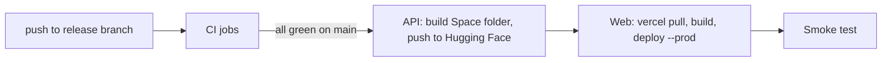

# CI/CD and deployment

## Hosting topology

| Piece | Host | Notes |
|---|---|---|
| Frontend (Next.js) | Vercel, project `invoiceiq` | Root directory `frontend`. Production domain `invoiceiq-ai.vercel.app` |
| API (FastAPI) | Hugging Face Space `Riya1104/InvoiceIQ` | Gradio SDK shell; `app.py` migrates, seeds the public workspace, then serves the API with uvicorn on port 7860 |
| Database | Supabase PostgreSQL via the session pooler | Free tier |
| Models | Git LFS in the repository | Copied into the Space by the build script |
| Event broker | Single-node Apache Kafka (KRaft) inside the same Space container | Ephemeral storage covered by the outbox and a reconciler, in-process fallback; a managed broker can be used by configuration |

Why this arrangement: all three services have a free tier with no card. A Space cannot host a managed broker, so a small single-node Kafka runs beside the API in the same container. The Space's free hardware sleeps after about two days without visitors, and the first request after a sleep takes about a minute. Supabase pauses idle free projects.

Latency note: the API runs in the US (AWS Ohio). A database in a distant region costs about 200 ms per query; a request makes several. Placing the database in the same region as the Space is the main available speed-up.

## Continuous integration

Workflows in `.github/workflows/`:

| Workflow | Runs | What it checks |
|---|---|---|
| **CI** (`ci.yml`) | Push to `main` and `invoiceiq-integration`, every pull request | Jobs below |
| Frontend CI | Changes under `frontend/` | Lint, TypeScript, tests and build |
| Repository security | Push and pull request | Privacy check for private local files, gitleaks secret scan over history, `pip-audit` of the Python dependencies (including the container variant), `npm audit` of production dependencies |
| AI guardrails and model contracts | Push and pull request | Prompt-injection guardrail tests, mutation authorization, model artifact verification, request limits, LLM telemetry, and versioned offline agent-safety cases |
| ML artifact integrity | Manual | Verifies model files against their fingerprints |

CI jobs:

- backend: fetches the model artifacts from Git LFS, downloads and checksum-verifies the public B2B dataset, starts a disposable PostgreSQL and verifies its identity before any migration, runs Ruff, applies migrations up, down and up again, migrates dedicated integration databases, runs the full test suite with an 80% coverage gate, and provisions and verifies the public workspaces.
- frontend: `npm ci`, type generation, `tsc`, ESLint, unit tests, production build, then Playwright journeys in Chromium against the built app.
- images: builds the backend and frontend container images.
- staging-compose-config: validates the staging Compose file.

## Continuous deployment

`deploy.yml` is a separate workflow in the Actions tab. A successful push-triggered CI run on `main` starts it automatically, and it checks out the exact commit CI tested. It can also be started manually with `workflow_dispatch`. Integration-branch and pull-request CI runs do not deploy production.

- Trigger: a separate `workflow_run` watches the `CI` workflow. The deployment jobs use repository secrets and run without the production environment's manual approval gate.
- API job: `scripts/build_hf_space.sh` assembles a runtime-only folder (no tests, env files or report images; binaries tracked by LFS), bundles the checksum-verified Kafka archive, and force-pushes it to the Space. A code-only redeploy of the Space takes under a minute to be running again. Hugging Face then rebuilds and restarts the Space, which migrates the database and seeds the public workspace.
- Web job: the Vercel CLI pulls the project's production settings, builds, and deploys the prebuilt output. The token is trimmed of stray whitespace.
- Smoke test: waits up to ten minutes for the API health check, then verifies the home page, opens a public-workspace session and fetches the overview, follow-ups and alerts endpoints with the same origin header a browser would send.

Repository secrets used: `HF_TOKEN` (a write token), `VERCEL_TOKEN`, `VERCEL_ORG_ID`, `VERCEL_PROJECT_ID`. Optional repository variables: `HF_SPACE`, `API_URL`, `SITE_URL`.

## Environment variables

**API (Space secrets and variables)**

| Variable | Purpose |
|---|---|
| `DATABASE_URL` | PostgreSQL URL, `postgresql+asyncpg://` form; use the pooler string and a password free of special characters |
| `GOOGLE_API_KEY` | Gemini for the assistant, reminder drafts, transcription and note embeddings |
| `INVOICEIQ_SHOWCASE_DATABASE` | Name of an approved database that may hold the public workspaces (`postgres` on the hosted database) |
| `INVOICEIQ_PORTAL_ENABLED`, `INVOICEIQ_PORTAL_SHOWCASE` | Enable the portal and the public workspace (set by `app.py`) |
| `LLM_MODEL` | Default `gemini-3.6-flash`; transcription prefers `gemini-3.5-flash-lite` |
| `KAFKA_BOOTSTRAP_SERVERS`, `KAFKA_SECURITY_PROTOCOL`, `KAFKA_SASL_MECHANISM`, `KAFKA_USERNAME`, `KAFKA_PASSWORD`, `OUTBOX_DISPATCH_ENABLED` | Optional broker connection |
| `REDIS_URL` | Optional distributed lock |
| `GROQ_API_KEY`, `GROQ_MODEL` | Fallback model for the assistant and reminder drafts |
| `RESEND_API_KEY` | Optional real reminder email in the older workflow |
| `SENTRY_DSN` | Optional error tracking |

**Frontend (Vercel)**

| Variable | Purpose |
|---|---|
| `INVOICEIQ_API_URL` | HTTPS URL of the API |
| `INVOICEIQ_PORTAL_ENABLED` | `true`, set before the build, because the redirect from `/` to `/home` is fixed at build time |

Never place an API key or database URL in a browser-exposed variable, and never commit `.env` files.

## Releasing

1. Wait for green CI on the exact commit.
2. Back up the database.
3. Migrations run when the Space starts (Alembic `upgrade head`). For anything beyond this deployment, run migrations as a separate, reviewed step.
4. Watch the automatic deploy and smoke test in the Actions tab.
5. Rotate any credential that was ever pasted into a chat, ticket or log.

## Rollback

- Frontend: promote the previous Vercel deployment.
- API: push the previous commit to the Space (or re-run the deploy on it).
- Database: migrations in this release add tables and nullable columns, so rolling code back leaves them unused; restore a snapshot if data must be undone.

## Local environments

- `./run.sh` starts PostgreSQL in Docker, migrates, and launches the API and web app with hot reload.
- `infra/docker-compose.yml` defines `db` (PostgreSQL 16), `kafka` (Apache Kafka 3.9), `redis` (7), `api` and `web`.
- `infra/compose.deploy.yml` is a loopback-only staging rehearsal with web, API, PostgreSQL and Redis.
- `deploy/local-kafka/docker-compose.yml` starts Redpanda and its console for trying the event pipeline locally.

Backups: `.github/workflows/backup.yml` runs nightly, once `BACKUP_DATABASE_URL` and `BACKUP_PASSPHRASE` are set as repository secrets; see [SECURITY_AND_PRIVACY.md](SECURITY_AND_PRIVACY.md).
