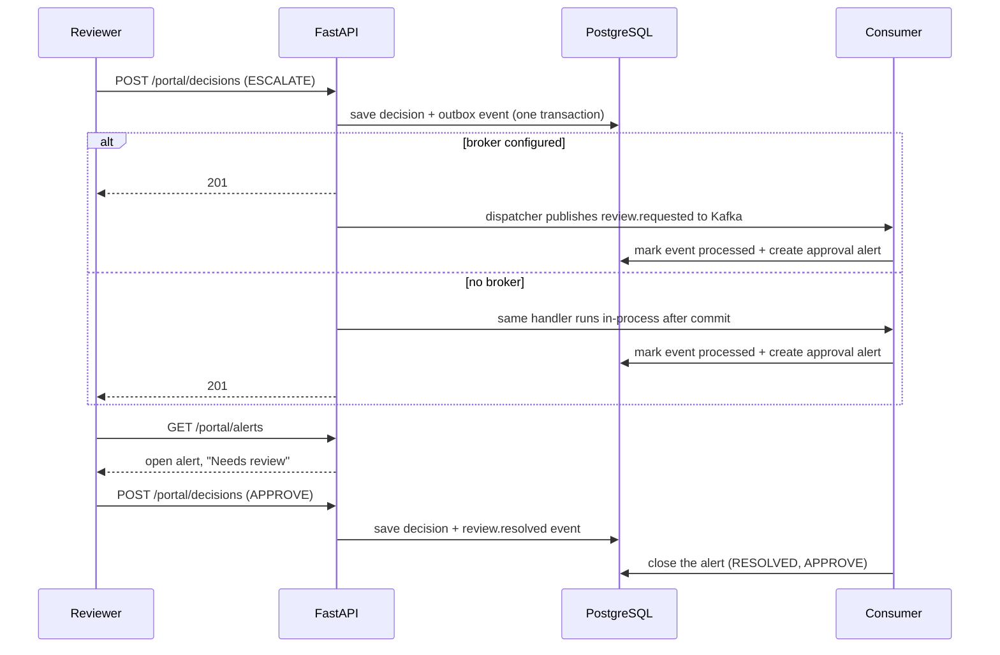

# Workflows

How the product behaves end to end, for users and for the system.

## 1. First visit: the public workspace

1. The visitor opens `/home` and clicks **Explore the product**.
2. The browser posts to `/api/portal/showcase`. The API creates a session on the shared public workspace with no account, and the proxy stores it in an HTTP-only cookie.
3. The visitor lands on the dashboard with about 700 invoices.
4. Any decision they record is tagged with their own session scope, so it is visible only to them. A shared baseline of past decisions keeps the recovery charts populated from the start.

## 2. Creating a real workspace

1. **Sign up** with email, name, company and a password of at least 12 characters.
2. A user, a customer workspace and an owner membership are created together, and the user is signed in.
3. **Import invoices** from a CSV. Expected columns: `invoice_number`, `counterparty`, `issue_date`, `posting_date`, `due_date`, `amount_total`, `amount_paid`, `payment_date`. Dates are `YYYY-MM-DD`; paid invoices need a payment date; up to 250 rows per upload.
4. The dashboard, recovery views and assistant now reflect the company's own data.
5. The owner or an admin can **score** the portfolio (up to 2,000 invoices) to attach a risk probability to each invoice.

## 3. Reviewing and deciding

1. On **Cases** or **Approvals**, the user searches or sorts invoices and chooses **Review**.
2. They pick `Escalate`, `Approve` or `Reject` and write a reason of at least three characters.
3. The server saves the decision and an event in one transaction. The recovery KPIs and charts update immediately (caches are cleared on write).
4. The status of an invoice is its latest decision. `Reset` returns it to unreviewed.

## 4. Escalation to approval alert (event-driven)

Alerts are scoped to the workspace, and showcase visitors see only their own. The panel refreshes every five seconds.

## 5. Asking the assistant

1. The user types a question, or taps the microphone.
2. Speech is recognised in the browser; if that fails, audio is recorded and transcribed by the server.
3. The server builds workspace facts (totals, aging, largest overdue invoices, recovery status) and asks Gemini for a plain-language answer grounded in them. The history of up to six turns is included.
4. The answer is shown and can be read aloud. Limits: 8 questions a minute per session.

## 6. The recovery workflow for an overdue case

1. **Detect overdue:** invoices past due with a balance open a recovery case.
2. **Run the workflow** (on demand, or by the optional scheduler): terminal cases stop; otherwise load context, score risk, diagnose, recommend.
3. **Policy check:** the deterministic engine approves, rejects or holds the recommendation. Held actions become `PENDING_APPROVAL` and the workflow stops.
4. **Human review:** an approver approves or rejects; both are audited with actor `HUMAN`.
5. **Execute and record:** approved actions run (reminder email, payment link, promise tracking, escalation, or a human-triggered voice call). Outcomes and events are recorded.
6. **Promise tracking:** a daily sweep marks promises fulfilled or broken; a broken promise forces escalation on the next cycle.

## 7. Change delivery

1. A developer pushes to a branch and opens a pull request. CI runs tests and scans.
2. After a merge to the release branch, CI runs again; once every job is green, the **Deploy** stage appears.
3. A reviewer approves it in GitHub. The API is pushed to the Hugging Face Space, the frontend is published to Vercel, and a smoke test checks the site, a showcase session and the data endpoints.

See [CICD_AND_DEPLOYMENT.md](CICD_AND_DEPLOYMENT.md).
